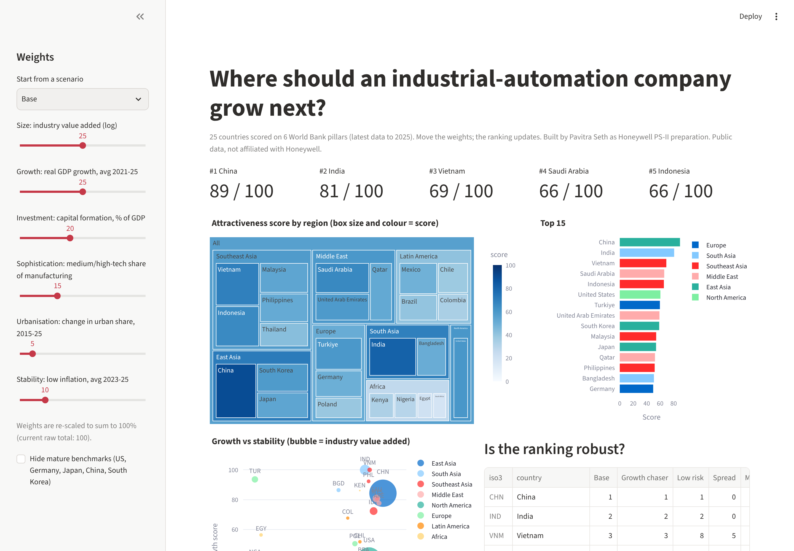

# Regional Growth Prioritisation Dashboard

An interactive Streamlit dashboard that ranks 25 countries on where an industrial-automation company should grow next. It scores each country on six World Bank pillars, and the weights are sliders, so the ranking updates as you change what matters. A robustness panel shows whether the answer depends on the weights.

Built by Pavitra Seth (BITS Pilani) as preparation for Honeywell PS-II. It uses public data only and is not affiliated with Honeywell.



## Run it
```bash
pip install -r requirements.txt
python pull_data.py      # optional: re-download the World Bank data (already included in data/raw)
python prepare.py        # clean, score and rank -> data/clean/
streamlit run app.py     # opens the dashboard in your browser
```
To publish it for free, go to share.streamlit.io, choose New app, pick this repo and select `app.py`.

**Files**
- `pull_data.py`: downloads 9 World Development Indicators (one CSV each).
- `prepare.py`: cleans the data, scores six pillars from 0 to 100, ranks countries under three weighting scenarios, and runs a leave-one-pillar-out test.
- `app.py`: the dashboard, with weight sliders, a treemap by region, the top 15, a growth vs stability chart, a robustness table, and a country card with a radar chart.
- `data/raw/`: indicator CSVs. `data/clean/`: `indicators.csv` and `scores.csv`.

## Pillars
| Pillar | Indicator | Base weight |
|---|---|---|
| Size | Industry value added, US$ (GDP × industry % of GDP), log scale | 25% |
| Growth | Real GDP growth, average 2021–25 | 25% |
| Investment | Gross capital formation, % of GDP | 20% |
| Sophistication | Medium and high-tech share of manufacturing value added | 15% |
| Urbanisation | Change in urban population share, 2015–25 | 5% |
| Stability | Low inflation, average 2023–25 (inverted) | 10% |

There are two alternative scenarios: **Growth chaser** (growth 40%, investment 25%) and **Low risk** (stability 25%, size 30%).

## Results (base case)
| Rank | Country | Score | Rank range across 3 scenarios |
|---|---|---|---|
| 1 | China | 89 | 1–1 |
| 2 | India | 81 | 2–2 |
| 3 | Vietnam | 69 | 3–8 |
| 4 | Saudi Arabia | 66 | 4–6 |
| 5 | Indonesia | 66 | 5–6 |
| 6 | United States | 60 | 3–13 |
| 7 | Turkiye | 60 | 4–18 |
| 8 | United Arab Emirates | 59 | 8–10 |

## Three takeaways
1. **India is the most robust emerging-market bet.** It ranks #2 under every scenario and moves zero places when any one pillar is dropped. It combines size ($1.0 trillion of industry value added), the fastest growth in the set (7.8% average) and high investment (34.6% of GDP).
2. **The next tier is Saudi Arabia, Indonesia and the UAE, which all stay in the top 10 under every scenario.** They map to Honeywell's process plays: LNG and refining in the Gulf, nickel, refining and LNG in Indonesia.
3. **Some rankings depend on how much risk you tolerate.**
   - Turkiye goes from #4 (growth chaser) to #18 (low risk) because of 49% inflation.
   - Vietnam drops from #3 to #8 in the low-risk case, so it is a growth bet, not a safe one.
   - The US moves the other way, from #13 to #3.

The "hide benchmarks" checkbox removes China, the US, Germany, Japan and South Korea, leaving a pure emerging-market list.

## Method
- **Data:** latest available year for each country (mostly 2025; the manufacturing-sophistication indicator is 2022).
- **Scaling:** each indicator is capped at the 5th and 95th percentiles, then min-max scaled to 0–100. Size uses a log scale, so the US and China don't flatten everyone else.
- **Missing values:** filled with the median and flagged in a `missing` column, never set to zero. Only Nigeria's investment figure is missing.
- **Robustness:** ranks are compared across three weight sets, and each pillar is dropped in turn.
- **Honeywell play** for each country (country card) is my judgment, not data.

## Limitations
- Growth is backward-looking (2021–25 actuals). IMF World Economic Outlook forecasts would be the next addition.
- Inflation is a simple stand-in for risk. Governance indicators would be better.
- Thailand's urbanisation jump looks like a change in statistical definition, which the capping limits.
- The tool ranks markets, not Honeywell's ability to win in them. Pair it with Honeywell's regional revenue from the 10-K.

## Sources
World Bank World Development Indicators, via the public [datasets/world-development-indicators](https://github.com/datasets/world-development-indicators) mirror, plus the World Bank Open Data portal (data.worldbank.org).
